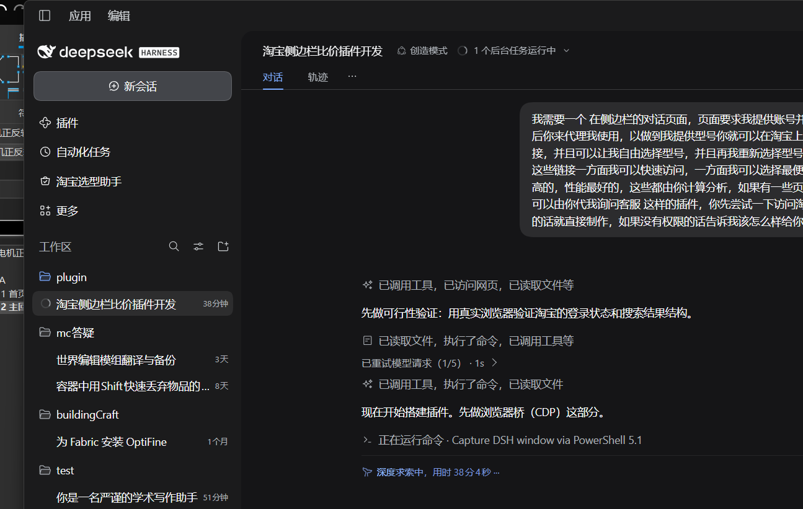
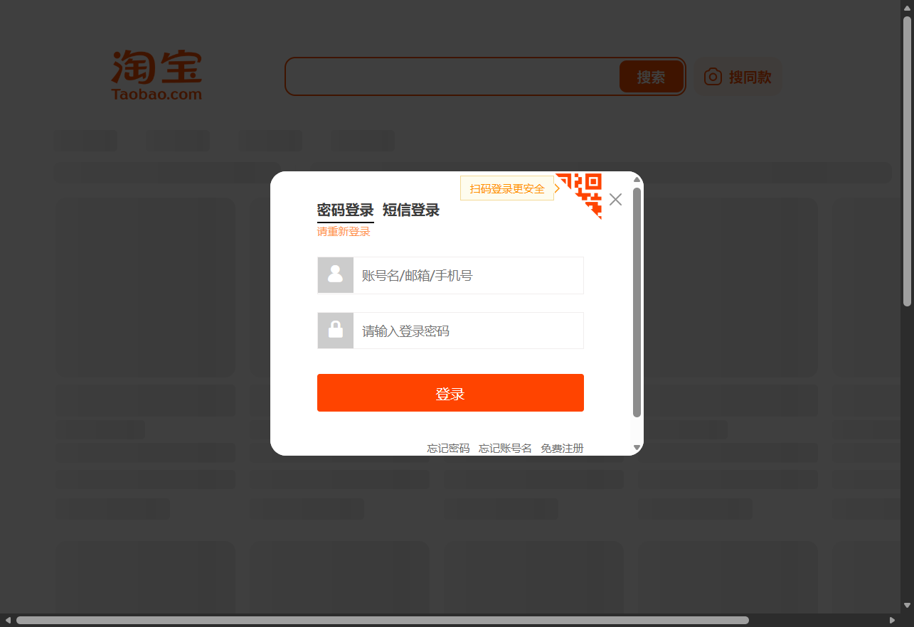

# 淘宝选型助手 · Taobao Picker for DSH

给 [DeepSeek Harness](https://github.com/) 桌面版用的侧边栏插件：**登录一次淘宝，报型号，自动比价、挑链接、导出 Excel**。

> 仅供学习与个人购物比价使用。插件不包含任何账号数据，登录态只保存在你自己的电脑上。

**当前版本：`0.1.0-beta.1`（首个公开测试版）** · [更新日志](CHANGELOG.md)



## 一条命令安装

```bash
# 最新测试版（跟随 main 分支）
dsh plugin --profile desktop install git+https://github.com/YuYia222/dsh-taobao-advisor.git

# 或锁定到某个测试版标签
dsh plugin --profile desktop install git+https://github.com/YuYia222/dsh-taobao-advisor.git#v0.1.0-beta.1
```

装好后重启 Harness，左侧栏出现「淘宝选型助手」。

卸载：

```bash
dsh plugin --profile desktop remove @local/dsh-taobao-advisor
```

> 需要本机有 `git`。命令里的 `<你的 profile>` 通常是 `desktop`。
> 也可以在 DSH 的「插件」页里点「安装插件」，填 `git+https://github.com/YuYia222/dsh-taobao-advisor.git`。

## 它做什么

- **单品比价**：输入型号（`iPhone 17 Pro 256G`、`小米15`、`微型断路器 3P`），给出「最便宜 / 性价比最高 / 性能最强」三组推荐 + 全部候选链接。
- **品牌 + 规格两级筛选**：自动识别品牌（正泰、施耐德、Apple、华为…30+）与规格（极数 `3P`、电流 `C32`、功率 `7.5KW`、容量 `256G`），可叠加。
- **批量比价 + Excel**：下载模板 → 一行一件商品 → 上传 → 逐条比价 → 导出含「汇总 / 全部链接」两张表的 xlsx。
- **代问客服**：自动生成问价话术，确认后由插件打开客服窗口发送（实验能力）。
- **后台运行**：默认无头浏览器，屏幕上不弹窗；需要人工过滑块时点「显示浏览器」。
- **扫码 / 短信 / 密码** 三种登录方式，二维码直接显示在面板里。



## 其他安装方式

**手动安装（不用命令行）**

1. 点右侧 **Code → Download ZIP**；
2. 解压，得到含 `package.json` 的目录；
3. DSH → 左侧「插件」→ 安装插件 → 选择该目录。

**发布到 registry 后**（见 [PUBLISH.md](PUBLISH.md)）

```bash
dsh plugin --profile <你的 profile> install @你的scope/taobao-advisor
```

## 首次使用

1. 左侧栏点「淘宝选型助手」。
2. 面板左侧就是实时二维码，手机淘宝扫一扫即可；也可以切到短信 / 密码登录。
3. 登录态保存在 `%LOCALAPPDATA%\dsh-taobao-advisor\browser`，**不经过任何服务器**。
4. 输入型号开始比价；「批量比价」页签可以传 Excel。

## 隐私

| 数据 | 位置 | 是否随插件分发 |
|---|---|---|
| 登录态 / cookie | `%LOCALAPPDATA%\dsh-taobao-advisor\browser` | 否 |
| 导出的 Excel | `%LOCALAPPDATA%\dsh-taobao-advisor\exports` | 否 |
| 当前型号 / 结果 / 账号名 | 进程内存 | 否（从不落盘） |
| 密码 | 只填入本机浏览器表单 | 否 |

插件包内只有代码。

## 已知限制

- **仅 Windows 验证过**：浏览器路径按 Edge/Chrome 默认安装位置查找，数据目录用 `%LOCALAPPDATA%`。
- 淘宝改版可能导致抓取规则失效，需要更新 `lib/taobao.js`。
- 列表页显示的是**最低 SKU 起价**，多规格商品（`1P2P3P4P`）要以商品页所选规格的实价为准。
- 型号匹配是启发式的，`全部链接` 表保留原始候选供人工复核。
- 单次批量最多 30 行，逐条串行（防风控）。

## 目录结构

这个仓库根目录**就是插件包**（所以可以直接用 `git+https://` 安装）：

```
package.json          插件清单（dsh.bundle + dsh.client）
cordis.patch.yml      装载补丁
index.js              宿主：面板接口、agent 工具、批量、Excel
client.js             面板 UI（预构建，纯 JS 无需打包）
lib/cdp.js            无依赖 CDP 客户端（Node 内置 WebSocket）
lib/taobao.js         登录 / 搜索 / 详情 / 客服
lib/analyze.js        型号匹配、品牌与规格抽取、三指标打分
lib/xlsx.js           xlsx 读写（零依赖，zip + XML）
locale/{zh,en}.json   显示名与描述
icon.svg              图标
docs/                 GitHub Pages 落地页
```

## 开发

- 面板代码是普通 JS，改完在面板顶栏点「刷新界面」即可生效（桌面版 Ctrl+R 无效）。
- 改宿主代码需要在「插件」页把插件关掉再打开一次；`index.js` 的 `BUILD` 与 `client.js` 的 `buildTag` 要一起改，否则面板会提示版本不一致。
- 发布前用 `npm pack --dry-run` 确认 `files` 白名单没漏文件（客户端预构建产物必须原样带上）。

## License

MIT，见 [LICENSE](LICENSE)。
